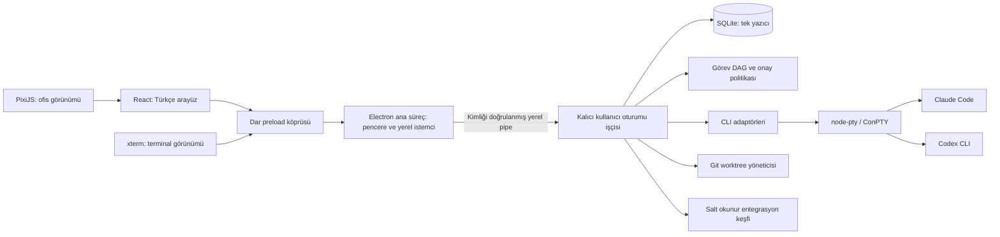

# AjanKatı — Bağımsız Mimari Önerisi

Durum: Faz 0 tasarımı; uygulanmadı. Tarih: 24 Ekim 2026. Bu belgedeki sayısal sınırlar ölçülmüş sonuç değil, önerilen başlangıç hedefleridir.

## Amaç ve kapsam

AjanKatı, mevcut Claude Code ve Codex CLI kurulumlarını gerçek oturumlarda kullanan, Türkçe öncelikli bir Windows masaüstü uygulaması olacak. İki ajan arasında görev devri, görünür terminaller, kalıcı görev/mesaj kayıtları ve insan onayı temel üründür. Ofis bu durumu gösterir; işin kendisini yürütmez.

Windows 11 x64, tek yerel kullanıcı ve yerel NTFS proje klasörü başlangıç kapsamıdır. Laptopta 8 GB RAM temel hedef; 16 GB masaüstü ek test ortamıdır. RTX 2060 gerekmeyecek. Docker, Python, Ruflo, Serena veya GitHub MCP zorunlu çalışma bağımlılığı değildir. Ağ paylaşımında SQLite, çok bilgisayarlı eşzamanlı veri paylaşımı, uzaktan telefon erişimi ve yerel model barındırma MVP dışıdır.

## Seçenekler ve öneri

| Seçenek | Kazanç | Bedel | Karar |
|---|---|---|---|
| Electron ana süreci + tepsi | Daha az süreç/protokol | UI uygulamasının çökmesi tüm koordinasyonu etkiler; bağımsız yeniden bağlanma zayıf | Prototip için mümkün; ürün temeli seçilmedi |
| Ayrı kullanıcı oturumu işçisi + Electron istemci | Pencere kapanır, PTY ve kuyruk yaşar; açık sahiplik | Yerel IPC, süreç denetimi ve paketleme gerekir | Önerilen |
| Windows servisi | Oturumdan bağımsız hizmet olanağı | Session 0, CLI kimliği, izinler ve yükseltme karmaşıklığı | MVP dışı |

Bu seçim kullanıcı tarafından önceden onaylanmış karar olarak sunulmuyor; istenen bağımsızlık ve donanım sınırları için Faz 0 önerisidir.

## Süreç ve güven sınırları

- **Renderer:** React, PixiJS, xterm. Node, dosya sistemi, süreç başlatma veya sır erişimi yok. Görevler için yalnız görüntü önbelleği; localStorage işletimsel gerçeklik kaynağı değil.
- **Preload:** isimlendirilmiş ve sürümlü yöntemler. Genel `invoke(channel, payload)`, `exec`, `readAnyFile` yok. Aboneliklerin kaldırılması zorunlu.
- **Electron ana süreç:** pencere, dosya seçici, bildirim, bağlantı ve tepsi istemcisi. Görev yürütmez, PTY sahibi olmaz. Gönderici pencere/frame/origin denetler.
- **İşçi:** Node.js çalışma zamanıyla ayrı paketlenen TypeScript uygulaması; Electron API'sine bağımlı değil. SQLite, scheduler, PTY, onay, süreç ağacı, worktree ve adaptörlerin tek sahibi. Uygulamanın paketlediği runtime mevcut global Node/CLI'yi değiştirmez. Native modüller işçi runtime ABI'sine göre paketlenecek.
- **CLI süreçleri:** kullanıcı hesabının yetkileriyle çalışan, çıktı ve önerileri güvenilmez kabul edilen dış süreçler. Gerçek işletim sistemi izolasyonu adaptör/ortam tarafından sağlanmalı; işçi onayı veya worktree tek başına sandbox değildir.

Önerilen gelecekteki modül sınırları: `apps/desktop/main`, `apps/desktop/preload`, `apps/desktop/renderer`; `apps/worker`; `packages/domain` (durumlar/DAG), `packages/contracts` (IPC şemaları), `packages/storage`, `packages/pty-host`, `packages/adapters/{claude,codex}`, `packages/policy`, `packages/discovery`, `packages/git-workspaces`, `packages/i18n`. Bunlar henüz oluşturulmuş dizin veya kaynak dosyalar değildir.

## Pencere, işçi ve bilgisayar yaşam döngüsü

“Pencere kapalıyken çalışmaya devam et” varsayılan kapalıdır. Etkinleştirme, geçerli proje/ajan/politika kapsamını ve mevcut oturumda maliyet doğurabileceğini açıklar. Bağımsız işçi GUI'den ayrılır; gizli renderer'a dayanmaz.

| Olay | Beklenen davranış |
|---|---|
| Pencere kapanır, arka plan kapalı | Yeni iş kabulünü kes; aktif işleri bitirme veya durdurma seçimini göster; kullanıcı durdurmayı seçince süreçleri kapat, kesilen denemeyi kaydet. |
| Pencere kapanır, arka plan açık | İşçi ve PTY'ler devam eder. Son UI aboneliği kalkar; Pixi/xterm/GPU görünümü kapanır. Onay isteyen iş bekler. |
| “Tümünü durdur ve çık” | Kalıcı durdurma isteği, yeni sevkiyatın kesilmesi, kontrollü kapatma, süre sonunda yalnız sahip olunan süreç ağacını sonlandırma. |
| GUI çöker | İşçi yaşamaya devam eder. Arka plan izni yoksa istemci heartbeat kaybından 15 saniye sonra yeni sevkiyatı keser; 30 saniyelik yeniden bağlanma penceresinden sonra aktif koşuları durdurur. Bu süreler testle ayarlanır. |
| İşçi çöker | PTY devamlılığı garanti edilmez; sahip olunan çocuklar Windows Job Object ile kapatılmalı. Yeni işçi eski `running` kayıtları `interrupted` yapar. Kendiliğinden yan etkili tekrar yok. |
| Ekran kilitlenir | Arka plan açık ve onay kapsamı geçerliyse çalışma sürebilir. Kullanıcıya ihtiyaç duyan iş ilerlemez. |
| Uyku/hibernasyon | İşlem ilerlemez. Son bilinen durum “Uyku nedeniyle kesinti / doğrulanıyor”; sahte çalışma süresi veya heartbeat üretilmez. |
| Uyanma | Süreç/oturum, pipe, politika ve süreler yeniden doğrulanır; geciken işler topluca başlatılmaz. |
| Güç kapalı / oturum kapatma | Çalışma yok. Yeniden başlatma yalnız görev kaydını korur; PTY'yi diriltmez. |

İşçi tek örnek kilidi + örnek kimliği + heartbeat kullanır. PID tek başına süreç kimliği sayılmaz; yeniden kullanım için başlangıç zamanı ve job sahipliği birlikte tutulur. GUI yeni işçi başlatmadan önce mevcut örneğe bağlanmayı dener. İşçi kendi isteği dışında genel süreç adıyla öldürme yapmaz.

Windows pipe erişimi mevcut kullanıcı SID'siyle sınırlandırılacak. Node'un varsayılan ACL davranışı yeterli sayılmayacak; seçilen yerel bağlayıcı/launcher ile DACL ve Job Object kanıtı M1 teslim kapısıdır. Bunlar doğrulanmadan arka plan/otonomi “hazır” gösterilmez. GUI bağlantısının kopması işçinin job nesnesini kapatmamalı; çocuk süreçlerin yaşam süresi işçiye bağlı olmalıdır.

Windows açılışında çalıştırma MVP'de yok. Sonraki sürümde ayrı opt-in olacak; pencere kapalı çalışma onayı başlangıç kaydı oluşturma izni sayılmaz. Uyku engelleme varsayılan kapalı; istenirse süreli ve görünür olacaktır. Güç kapalıyken çalışma hiçbir yerde vaat edilmeyecek.

## Veri modeli ve işlemler

İşçi SQLite'ın tek yazıcısıdır. Yerel kullanıcı veri dizini altında DB; kullanıcı projelerinden ayrı, kullanıcı ACL'siyle korunan çalışma alanı. Renderer doğrudan SQL çalıştırmaz. SQLite şifreli kasa değildir; kimlik bilgileri buraya konmaz.

| Kayıt | Temel alanlar / kural |
|---|---|
| `projects` | Kimlik, kanonik kök, repo kimliği, trust/onay sürümü; UI rastgele kök gönderemez. |
| `agents` | Sağlayıcı, doğrulanan executable kimliği, capability sürümü, rol, aktif politika. |
| `tasks` / `task_edges` | Proje, açıklama, durum, revizyon; kenarlar aynı projede, kendine bağ ve döngü yasak. |
| `runs` / `sessions` | Görev denemesi, epoch, lease, başlangıç/son, adapter sürümü, işçi örneği, sağlayıcı sessionId; görev ile terminal oturumu ayrı. |
| `messages` / `deliveries` | Gönderici, alıcı, task/run bağlantısı, içerik, teslim denemesi, benzersiz idempotency anahtarı; teslim edilmek işlenmek değildir. |
| `events` / `outbox` | Artan sıra, şema sürümü, neden/ilişki kimlikleri; aynı transaction içinde durum ve olay. |
| `approvals` | Eylem özeti/hash, görev/run, politika sürümü, kapsam, bitiş zamanı, insan kararı; yalnız ilgili eylem için geçerli. |
| `schedules` / `schedule_occurrences` | Saat dilimi, vade, kaçırılan iş politikası; `(scheduleId, dueAt)` benzersiz. |
| `artifacts` / `worktrees` | Proje kapsamlı yol, hash, üretici deneme, base commit, diff özeti; kaynak içerik DB'ye zorunlu kopyalanmaz. |
| `usage_samples` | Sağlayıcı kaynağı, ölçüm türü, delta/kümülatif ayrımı, session/epoch ve fiyat sürümü; bilinmeyen değer NULL. |
| `memory_notes` | Proje/görev, kaynak olay, insan onay durumu ve sürüm; model özeti doğrulanmış gerçek sayılmaz. |

WAL, foreign keys, bounded busy timeout; yazma dayanıklılığı için başlangıç tercihi `synchronous=FULL`. İşlemler kısa tutulur; PTY/ağ/Git çağrısı sırasında DB transaction açık kalmaz. Görev sahiplenme ve lease alma atomik koşullu güncellemedir. Transaction commit başarısızsa CLI sevkiyatı yapılmaz. Disk dolduğunda yeni iş durur ve görünür hata verilir.

DB schema sürümü ileri doğru migration ile yönetilir. Migration öncesi tutarlı SQLite yedeği alınır; açık WAL dosyasını tek başına kopyalamak yedek sayılmaz. Bozuk DB sessizce boş DB ile değiştirilmez. Olay kayıtlarıyla durum tabloları aynı işlemde güncellenir; MVP genel amaçlı event-sourcing altyapısı kurmaz.

## Görev DAG ve iki ajan akışı

Durumlar: `draft → ready → running → awaiting_review → succeeded`. Ek durumlar `blocked`, `awaiting_approval`, `failed`, `cancelled`, `interrupted`. `blocked` nedeni bağımlılık, eksik yetenek veya kaynak baskısı olabilir. Bağımlılık ancak `succeeded` olduğunda karşılanır; iptal/hata başarı sayılmaz. Aktif görevin kenarlarını değiştirmek önce duraklatma ve revizyon kontrolü gerektirir.

Örnek: kullanıcı bir hedef verir; Claude “uygulayıcı”, Codex “inceleyici” olarak atanır. Kullanıcı gözden geçirilebilir görev sınırını onaylar. İşçi A görevini sahiplenir ve worktree'de başlatır. A'nın “bitti” mesajı işi `awaiting_review` yapar; otomatik başarı veya merge yapmaz. Kullanıcı A'nın teslimini kabul eder; A `succeeded` olur ve ona bağlı inceleme görevi B `ready` olur. B aynı teslimin hash/base commit/diff kaydını salt okunur inceleme girdisi olarak alır. B düzeltme isterse önceki denemeyi değiştirmek yerine yeni revizyon/görev açılır. Sonuç ve bütünleştirme kararı insandadır.

Bağımsız iki görev iki ayrı worktree'de paralel olabilir. Aynı çalışma dizinine iki yazıcı verilmez. İnceleme işi yazma isterse yeni kapsam/onay ve ayrı worktree gerekir. Ajanlar yalnız görev değişikliği önerir; asıl durum makinesi ve yeni ajan açma yetkisi işçide kalır.

Mesajlar transaction outbox ile en az bir kez teslim girişimine uygundur. Alıcıya `(messageId, runId)` üzerinden tekrar baskılama yapılır. CLI'nin onaylamadığı gönderimin gerçekleşip gerçekleşmediği çökme sonrası belirsizse `delivery_uncertain` kaydı açılır; kör yeniden istem gönderimi yapılmaz. Dosya yazma, Git ve model çağrılarında uçtan uca exactly-once garanti edilmez.

## Olaylar ve terminal veri yolu

Domain olayı: `schemaVersion`, `eventId`, `sequence`, `projectId`, `taskId?`, `runId?`, `agentId?`, `occurredAt`, `observedAt`, `source`, `confidence`, `correlationId`, `payload`. Sağlayıcı adları yalnız adaptör alanında kalır. `tool.started`, `tool.completed`, `approval.requested`, `turn.completed`, `process.exited`, `usage.observed`, `session.unavailable` birbirinden farklıdır. Terminal sessizliği, process çıkışı veya tek bir Stop olayı görevin başarı kanıtı değildir.

Ham PTY akışı domain event defterine her byte için yazılmaz. Run/epoch başına sıralı terminal parçaları, sınırlı ring buffer ve ayrı abonelik/ack akışı kullanılır. Renderer yeniden bağlanınca durable olay cursor'undan durumunu alır; terminal için mevcut tamponu ve mümkünse ekrandaki yeniden çizimi ister. Tam terminal geçmişi varsayılan kalıcı değildir; tampon dışında kalan çıktı için “Önceki terminal çıktısı mevcut değil” gösterilir. Kalıcı replay sonradan opt-in olabilir; gizlilik ve kota gerektirir.

Başlangıç sınırları: PTY başına 2 MiB ham ring buffer, görünür xterm başına 5.000 scrollback satırı, aktif terminal başına 256 KiB bekleyen istemci kuyruğu; yavaş istemci koparılıp yeniden senkronize edilir. Ham akışta kayıp olursa sıra boşluğu bildirilir; terminal doğruymuş gibi sessiz byte kırpılmaz. Resize/input yalnız geçerli oturuma gider; eski epoch olayları yeni koşuya karışmaz. Aynı oturumda tek input sahibi vardır; insan yazarken otomatik gönderim bekler.

## Zamanlama, bellek ve keşif

Zamanlama işçidedir; UI timer'ı sevkiyat yapmaz. İlk MVP'de tek seferlik ve basit aralıklı yerel işler yeterli. İleride haftalık takvim için IANA saat dilimi saklanır; Türkçe dil seçimi saat dilimi seçimi değildir. Varsayılan kaçırılan iş davranışı `skip`; kullanıcı seçerse en fazla bir telafi çalışması. Tekrar sayısı ve toplam süre sınırlı; uyku sonrası birikmiş işleri fırtına gibi başlatma yok. Çakışan tekrarlar varsayılan birleştirilir.

Bellek önce görev sonuçları, onaylı notlar ve arama ile sınırlı; vektör veritabanı, embedding modeli ve kendiliğinden özetleyici ajan yok. Projeler arasında bellek paylaşımı kapalı. MCP/skill keşfi üstveri seviyesindedir; keşif, çalıştırma yetkisi veya güvenilirlik onayı değildir. Ayrıntılar [adaptörlerde](03-AGENT-ADAPTERS.md).

## Performans ve Türkçe deneyim

- Laptop: en fazla iki açık ajan oturumu; varsayılan tek aktif görev, ikinci eşzamanlı koşu kullanıcı seçimi ve kaynak kontrolüyle. Masaüstü: iki aktif görev. 8 GB cihazda iki aktif koşu kabul testini geçmezse özellik sınırlaması açıkça gösterilir.
- Ajanlar ve OS hariç AjanKatı süreçlerinin toplam boşta private working set hedefi ≤450 MiB; boşta 60 saniye ortalama CPU hedefi <%3. Görünür ofis 30 FPS, düşük güçte 15 FPS; gizli/kapalı sahnede ticker yok. Bunlar gerçek ölçümle doğrulanacak hedeflerdir.
- Pixi varsayılan çözünürlük katsayısı 1, en fazla 1,5; kullanıcı erişilebilirlik ölçeğiyle dengelenir. GPU bağlamı kaybında metin/görev listesi çalışmayı sürdürür. Gereksiz editör, tarayıcı, yerel model veya WebGL terminal örneği yüklenmez.
- Varsayılan `tr-TR`; `İ/ı/Ş/Ğ/Ü/Ö/Ç` font, dosya adı, arama ve terminal giriş testleri zorunlu. Sağlayıcı çıktısı çevrilip değiştirilmez. Durum metinleri “Çalışıyor”, “Onay bekliyor”, “Bağlantı doğrulanıyor”, “Kesildi”.
- Özgün masa/karakter/renk düzeni; televizyon karakteri veya referans harita yok. Görsel hareket gerçek olaydan türetilir. Demo varsa görünür “Demo — gerçek ajan çalışmıyor” etiketiyle tamamen ayrı veri kaynağıdır.

## Kabul sınırı ve açık riskler

Pencere kapalı gerçek iki ajan akışı, işçi yeniden bağlanması, kayıpsız görev kayıtları, onayın atlanmaması ve global ayarların değişmemesi doğrulanmadan MVP tamamlandı denmez. CLI sürüm protokolleri, Windows native paketleme, DACL/Job Object, sağlayıcı sandbox desteği ve gerçek bellek tüketimi açık doğrulama kapılarıdır. Pencere bağımsızlığı süreç çökmesinden, süreç çökmesi güç kesintisinden ayrı test edilir. [Güvenlik modeli](04-SECURITY-MODEL.md) bu mimarinin zorunlu parçasıdır.
